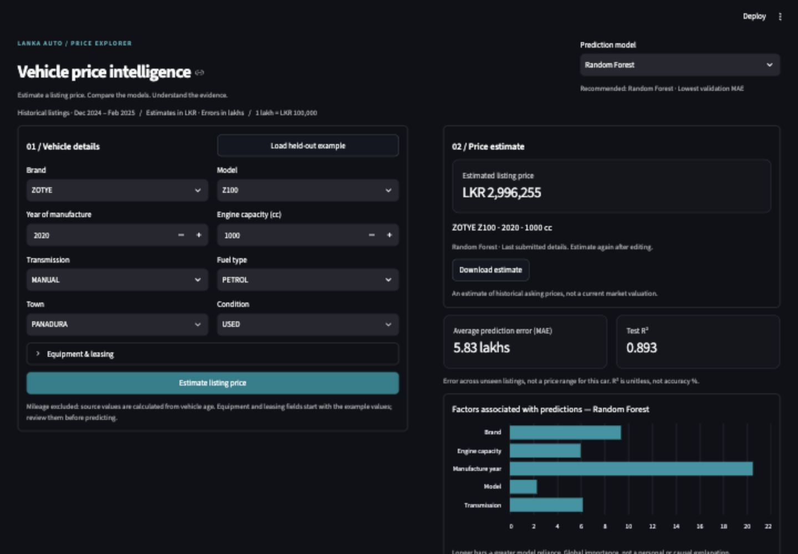
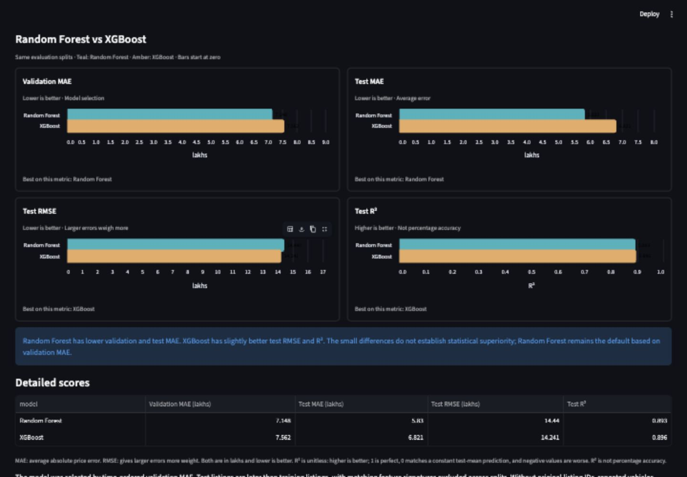

# Sri Lankan Vehicle Listing Price Explorer

A reproducible tabular regression coursework project comparing Random Forest and XGBoost for the class activity. Includes temporal validation,
model export, an unseen example, an analysis notebook and a Streamlit interface.

## Live application

[Open the Vehicle Listing Price Explorer](https://sri-lanka-vehicle-price-prediction.streamlit.app/)

Hosted on Streamlit Community Cloud. The app is private: sign in with an account
that has been granted access. Repository access and app access are managed separately.

## Interface preview

Screenshots below show the local application interface using the saved models.

### Price estimation

Enter vehicle details, choose Random Forest or XGBoost, and estimate the listing
price in LKR. The selected model's error metrics and feature importance appear
alongside the result.



### Model comparison

Compare both models on the same evaluation splits. Random Forest has lower
validation and test MAE; XGBoost has slightly better test RMSE and R².



## Start the application

From this project directory:

```bash
source .venv/bin/activate
streamlit run app/app.py
```

On macOS, XGBoost also requires `brew install libomp`.

For a fresh installation (Python 3.12 recommended):

```bash
python3.12 -m venv .venv
source .venv/bin/activate
python -m pip install -r requirements-lock.txt
python -m src.train
streamlit run app/app.py
```

`requirements-lock.txt` records the tested environment. `requirements.txt` gives
portable version ranges if exact platform-specific versions cannot be installed.
Re-train the pickle after changing dependency versions.

## Reproduce the analysis

```bash
python -m src.train
python scripts/interpret_results.py
python scripts/build_report.py
python -m src.predict
python -m pytest -q
```

Training writes the comparison, all search candidates, test predictions,
per-brand errors, plots, split IDs, data audit and trusted pickle. Training is
CPU-only. It selects the model by validation MAE before evaluating held-out data.
`notebooks/vehicle_price_analysis.ipynb` presents the full workflow and results;
its training cell can rebuild missing artifacts or explicitly retrain them.

## Data and critical limitations

Source: [Prasad Nirmal, SriLankan Vehicle(Car) Price Dataset, version 3](https://www.kaggle.com/datasets/prasadnirmal/srilankan-second-vehiclecar-price-dataset).
Publisher metadata identifies Ikman.lk and Riyasewana.com as listing sources and
lists the MIT license. Original API metadata is preserved in
`data/raw/kaggle_metadata.json`; original CSV is in `data/raw/car_price_dataset.csv`.
Data was downloaded on 9 October 2026. The publisher last updated it in February 2025.

- The CSV contains 9,788 advertisements, not verified completed transactions.
- Dates run from 3 December 2024 through 5 February 2025.
- **Price units are LKR lakhs**, confirmed by the project owner. One lakh equals
  LKR 100,000. Training targets and saved CSV metrics stay in lakhs; the app
  converts predictions to LKR and displays MAE, RMSE and importance in lakhs for readability. The prediction JSON
  includes `prediction` in lakhs and `prediction_lkr` in rupees.
- **All mileage values equal `(2025 - YOM) * 11000`.** Mileage is excluded from
  predictors and the interface; no claim about actual mileage effects is made.
- The publisher already preprocessed the data; original imputation and price
  cleaning cannot be reconstructed. No raw nulls does not prove complete observations.
- Feature signatures are used to reduce possible re-listing overlap. Without
  original listing IDs, duplicate identities cannot be guaranteed; identical
  signatures can also refer to different cars.
- The app describes the historical source market, not current 2026 prices.
- Global importance is associative, not causal or an individual explanation.

## Evaluation design

Remove invalid targets/dates/years, trim categorical whitespace, remove exact
duplicates excluding the source index and omit the deterministic mileage field.
Keep the latest record as a single-sample demo and exclude its full feature group
from development. Reserve the latest 20% of unique dates for testing; remove
matching test feature signatures from earlier training records. Use three expanding
time folds inside training, also purging matching validation signatures.

Imputation and one-hot encoding are fitted inside every fold. Rare categories
are pooled; unknown categories are handled. Both tree models do not need numeric scaling. Compare explicit, bounded model
configurations; choose minimum validation MAE. Preserve test scores for all models
without choosing the winner from test performance. Do not retune on these scores.

## Assignment mapping

| Requirement | Evidence |
|---|---|
| Sri Lankan dataset and provenance | Raw CSV, metadata, report |
| Analysis and preprocessing | Notebook, audit, training summary |
| Non-default RF and XGBoost parameters | `src/train.py`, experiments CSV |
| Comparison and interpretation | Report, model comparison, figures |
| Single-sample inference | `models/demo.json`, prediction CLI |
| Exported pipeline | `models/model.pkl` |
| Prediction interface | `app/app.py`, `docs/interface.md` |
| Validation | `tests/test_pipeline.py` |

Soft voting is a classification technique; this regression project compares
regressors. Stacking is optional and not implemented. A hosted URL is not required
by the supplied guideline; the private hosted app is linked above. Moodle submission remains the
student's submission step. Review the report and be prepared to explain every
model, preprocessing choice and limitation in your own words.


## Model switching
Both fitted pipelines are saved separately and registered in `models/metadata.json`.
Use the **Prediction model** dropdown, then click **Estimate listing price**.
Random Forest remains the validation-recommended default. Switching clears the previous
estimate and updates the selected model’s test MAE. Downloaded results include the
model name. The feature importance chart updates to the selected model’s own permutation importance. CLI example:
`python -m src.predict --model XGBoost`.

The app includes model-specific strengths, limitations, score interpretation and
actual-versus-predicted/residual graphs. Regenerate these after retraining with
`python scripts/interpret_results.py`. Full text: `reports/results_interpretation.md`.

Optional dataset explorer: open the third analysis tab and enable the explorer. Inspect raw or cleaned records, filter by brand/split, view distributions and download the filtered view. This is read-only and does not affect training. Processed records are shown before pipeline encoding.
