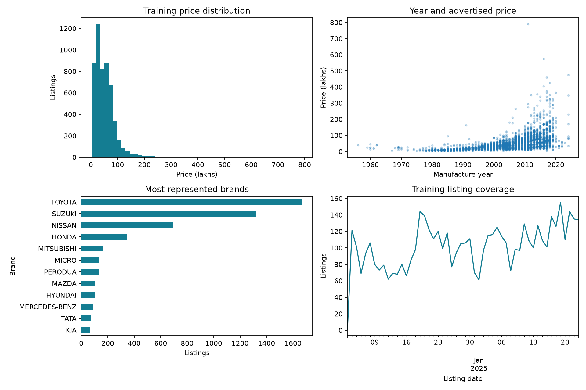

# Sri Lankan Vehicle Listing Price Prediction

## Technical Report

**Author:** Sithum Wickramanayaka

## Abstract
This study evaluates six regression approaches for predicting historical advertised
vehicle prices in Sri Lanka. The dataset contains 9,788 listings collected
between December 2024 and February 2025. Training-only exploration informs model
selection, while temporal validation and feature-group purging reduce leakage.
The comparison includes Random Forest, XGBoost, CatBoost, LightGBM, Ridge and a
Random Forest–XGBoost stack with a Ridge meta-model. Random Forest achieves the
lowest validation MAE of 7.15 lakhs and a test MAE of
5.83 lakhs. A deployed Streamlit application supports
single-vehicle inference and interactive inspection of the results. Because the
test set was examined during earlier development, the expanded findings are exploratory
and require confirmation using newly collected listings.

## Contents

1. Objective and local relevance
2. Dataset and provenance
3. Exploratory data analysis
4. Data preparation and leakage controls
5. Model selection and preprocessing
6. Evaluation and model justification
7. Error analysis
8. Comparison with existing approaches
9. Single-sample inference and user interface
10. Deployment and repository
11. Limitations and future evaluation
12. Conclusion
13. References

Appendix A provides model-specific results and diagnostic figures.

## 1. Objective and local relevance
Predict historical advertised vehicle prices from tabular listing characteristics.
Buyers and sellers can explore how vehicle characteristics relate to asking prices,
while users can compare models and inspect their limitations.
It does not estimate verified transaction prices or current 2026 market values.

## 2. Dataset and provenance
[Prasad Nirmal, SriLankan Vehicle(Car) Price Dataset, version 3](https://www.kaggle.com/datasets/prasadnirmal/srilankan-second-vehiclecar-price-dataset).
Publisher metadata identifies Ikman.lk and Riyasewana.com as sources and lists MIT
licensing. Original CSV and metadata are retained in `data/raw`.
SHA-256: `4208d2673cf4d9c8d3d6042dc8a1b97004671812441975f5879550059fbce1ab`.
There are 9,788 source rows, spanning 2024-12-03 to 2025-02-05.
Price is in LKR lakhs, confirmed by the project owner; 1 lakh is LKR 100,000.

## 3. Exploratory data analysis
Exploration in `scripts/analyze_data.py` uses only the training partition.
The training price median is 42.5 lakhs, 95th percentile
120.0, maximum 790.0, and skewness 3.80.
The long upper tail motivates reporting RMSE and price-band errors alongside MAE.
Extreme observations remain in evaluation rather than being removed to improve scores.

| Feature | Distinct values | Categories with fewer than 3 rows | Rows in rare categories |
|---|---|---|---|
| brand | 48 | 14 | 18 |
| model | 1061 | 758 | 893 |
| gear | 2 | 0 | 0 |
| fuel | 4 | 0 | 0 |
| town | 106 | 6 | 6 |
| leasing | 2 | 0 | 0 |
| condition | 2 | 0 | 0 |
| air_condition | 2 | 0 | 0 |
| power_steering | 2 | 0 | 0 |
| power_mirror | 2 | 0 | 0 |
| power_window | 2 | 0 | 0 |

Many model labels are rare, motivating native categorical handling and regularized
one-hot alternatives. Year/price Spearman association is
0.65; engine capacity/price association is
0.07. These are marginal associations,
not causal effects or sufficient reasons to remove an interacting feature.

## 4. Data preparation and leakage controls
18 exact duplicate rows were removed after category trimming,
and 0 rows failed target/date/year checks. No literal source nulls
were found, but the publisher already preprocessed the table; missing original
observations and prior imputation cannot be reconstructed.
Mileage equals `(2025 - year) * 11000` throughout the source and is excluded.
The exported index, date, target and group identifiers are not predictors.

The latest record is reserved for a single-example demo, excluding its feature
signature from development. Test dates start on 2025-01-24. Matching feature
groups are removed from earlier training data (411 rows).
There are 5,285 training, 4,073 test and one demo row.
Feature signatures are a conservative proxy; without original listing IDs they
cannot establish true vehicle identity. Three expanding temporal folds are used
for parameter search, with matching validation groups purged from each training fold.

## 5. Model selection and preprocessing

- **Random Forest:** bagging reference for nonlinear interactions and variance reduction.
- **XGBoost:** regularized sequential boosting for nonlinear interactions.
- **CatBoost:** native categorical processing is relevant to rare vehicle model labels.
- **LightGBM:** an efficient histogram-based boosting alternative with bounded leaf growth.
- **Ridge:** additive linear comparison to test whether tree complexity adds value.
- **Stacking:** fixed RF and XGBoost pipelines combined through scaled Ridge regression.
- **Training median:** no-feature reference benchmark, not a selectable app model.

All preprocessing is fitted within folds. RF, XGBoost, LightGBM and Ridge use
numeric median and categorical mode imputation plus one-hot encoding with rare
category pooling. Ridge scales numeric inputs; tree models do not require scaling.
CatBoost receives string categories with a missing marker and fold-fitted numeric
median imputation. No globally fitted target encoder is used.

RF, XGBoost, CatBoost and LightGBM each compare three explicitly constrained
configurations. Ridge compares alpha 1, 10 and 100. Actual settings and every search
result are in `experiments.csv`; bounded searches are not exhaustive optimization.
CatBoost's adapter supplies categorical names during fit for sklearn compatibility.
LightGBM uses ordinary GBDT with row sampling, not a replication of GOSS.
Stacking uses inner purged temporal out-of-fold predictions to train its Ridge
meta-model (alpha 10), then refits bases on the training partition. Outer temporal
folds evaluate the complete stack. Its bases are fixed, not selected with outer
validation labels. Earliest rows without out-of-fold predictions do not train Ridge.

## 6. Evaluation and model justification
Mean validation MAE is the selection rule fixed before the expanded run. MAE
expresses average monetary error directly; RMSE emphasizes large mistakes and R²
is unitless, not percentage accuracy. Fold standard deviation is descriptive,
not a confidence interval. Timing includes parameter search and refitting on this
machine; hardware-specific timings are not published-paper speed comparisons.

### Predictive performance

| Model | Validation MAE (lakhs) | Fold SD (lakhs) | Test MAE (lakhs) | Test RMSE (lakhs) | Test R² |
|---|---|---|---|---|---|
| Random Forest | 7.148 | 0.146 | 5.830 | 14.440 | 0.893 |
| Stacking | 7.299 | 0.249 | 6.475 | 14.411 | 0.894 |
| XGBoost | 7.562 | 0.312 | 6.821 | 14.241 | 0.896 |
| CatBoost | 8.740 | 0.364 | 8.414 | 15.606 | 0.875 |
| LightGBM | 9.410 | 0.230 | 7.590 | 15.283 | 0.880 |
| Ridge | 11.124 | 0.671 | 9.994 | 20.694 | 0.781 |

### Computational performance

| Model | Training (s) | Prediction (ms/row) |
|---|---|---|
| Random Forest | 7.708 | 0.012 |
| Stacking | 9.915 | 0.015 |
| XGBoost | 1.388 | 0.004 |
| CatBoost | 4.273 | 0.002 |
| LightGBM | 1.807 | 0.007 |
| Ridge | 0.244 | 0.002 |

### Model choice and evidence

**Random Forest** is selected because it has the lowest mean validation MAE
(**7.15 lakhs**) among the evaluated configurations. Test MAE is
**5.83 lakhs**, compared with **28.67** for a
training-median prediction (79.7% lower error on this historical split).
This demonstrates improvement over a simple local benchmark, not over external studies.

The training data has **1,061 model labels**, including **758** occurring fewer
than three times. Median training price is **42.5 lakhs** and
95th percentile **120.0 lakhs**. CatBoost tests native categorical
handling; LightGBM tests another efficient nonlinear approach; Ridge provides a
simpler additive reference. RF, XGBoost and stacking provide complementary ensemble comparisons.

Selection uses MAE because it measures average monetary error directly. RMSE
reveals the influence of large mistakes; R² is not percentage accuracy. Runtime
and fold variation are supporting evidence, not alternate post-hoc selection rules.
A more complex model is not automatically better. Error by actual-price band and
unseen model label must be considered before trusting an individual estimate.

**Limit:** this test split was already inspected during earlier development. Expanded results are
exploratory. Newly collected future listings are required for independent confirmation.
The source covers December 2024–February 2025; estimates are historical asking
prices rather than current valuations or verified sale prices.

## 7. Error analysis
The band table below uses actual target prices for retrospective analysis only;
those bands are not available when making a new prediction. Counts matter:
small subgroups cannot establish reliable group-level performance.

| Model | Actual price band (lakhs) | Listings | MAE (lakhs) | RMSE (lakhs) |
|---|---|---|---|---|
| Random Forest | 0–25 | 938 | 3.984 | 7.623 |
| Random Forest | 25–50 | 1307 | 4.025 | 7.912 |
| Random Forest | 50–100 | 1467 | 5.240 | 9.774 |
| Random Forest | 100–200 | 299 | 12.406 | 21.292 |
| Random Forest | >200 | 62 | 54.080 | 83.984 |
| XGBoost | 0–25 | 938 | 5.191 | 9.362 |
| XGBoost | 25–50 | 1307 | 4.984 | 8.400 |
| XGBoost | 50–100 | 1467 | 6.295 | 10.749 |
| XGBoost | 100–200 | 299 | 14.018 | 21.792 |
| XGBoost | >200 | 62 | 47.974 | 74.062 |
| CatBoost | 0–25 | 938 | 5.949 | 9.824 |
| CatBoost | 25–50 | 1307 | 5.760 | 8.970 |
| CatBoost | 50–100 | 1467 | 7.798 | 12.323 |
| CatBoost | 100–200 | 299 | 21.727 | 27.766 |
| CatBoost | >200 | 62 | 52.043 | 74.383 |
| LightGBM | 0–25 | 938 | 5.452 | 9.402 |
| LightGBM | 25–50 | 1307 | 5.375 | 8.885 |
| LightGBM | 50–100 | 1467 | 7.081 | 11.588 |
| LightGBM | 100–200 | 299 | 17.041 | 24.746 |
| LightGBM | >200 | 62 | 53.081 | 78.813 |
| Ridge | 0–25 | 938 | 9.450 | 14.718 |
| Ridge | 25–50 | 1307 | 7.087 | 13.108 |
| Ridge | 50–100 | 1467 | 7.426 | 13.361 |
| Ridge | 100–200 | 299 | 19.862 | 26.525 |
| Ridge | >200 | 62 | 92.647 | 116.693 |
| Stacking | 0–25 | 938 | 4.355 | 8.304 |
| Stacking | 25–50 | 1307 | 4.703 | 8.438 |
| Stacking | 50–100 | 1467 | 6.173 | 10.391 |
| Stacking | 100–200 | 299 | 13.469 | 22.157 |
| Stacking | >200 | 62 | 49.293 | 78.588 |

| Model | Model-label coverage | Listings | MAE (lakhs) |
|---|---|---|---|
| Random Forest | Seen model label | 3484 | 4.830 |
| Random Forest | Unseen model label | 589 | 11.748 |
| XGBoost | Seen model label | 3484 | 5.993 |
| XGBoost | Unseen model label | 589 | 11.721 |
| CatBoost | Seen model label | 3484 | 7.664 |
| CatBoost | Unseen model label | 589 | 12.851 |
| LightGBM | Seen model label | 3484 | 6.760 |
| LightGBM | Unseen model label | 589 | 12.497 |
| Ridge | Seen model label | 3484 | 8.379 |
| Ridge | Unseen model label | 589 | 19.542 |
| Stacking | Seen model label | 3484 | 5.622 |
| Stacking | Unseen model label | 589 | 11.518 |

Per-brand counts and MAE for every model are saved in `errors_by_brand_all_models.csv`.
Permutation importance measures how much test MAE changes when an input is shuffled.
It explains global reliance, not causation or the reason for a single prediction.
Correlated inputs can share importance; shuffling may create implausible vehicles.

## 8. Comparison with existing approaches
Sources checked on 14 October 2026. This is a methodological comparison, not a
replication of published scores. Our controlled numerical comparisons use our
own identical training/validation/test partitions.

| Approach | Source evidence | Comparison with this project | Limit of the comparison |
|---|---|---|---|
| Sri Lankan used-car regression and averaging | Basnayaka (2023) compares linear regression, Random Forest, Extra Trees, gradient boosting, LightGBM and XGBoost, then averages predictions. | We evaluate related linear and tree families; retain RF/XGBoost stacking instead of simple averaging; audit synthetic mileage and use purged temporal evaluation. | The repository abstract reports “accuracy”; its metric and split are not sufficiently specified for numerical equivalence to our MAE/R². We do not claim to reproduce or outperform it. |
| CatBoost | Prokhorenkova et al. (2018) present ordered boosting and categorical-feature processing. | Native categorical input is relevant to our many rare vehicle model labels; encoding is fitted within training folds. | General benchmark results do not guarantee benefits for Sri Lankan vehicle listings. Our configuration uses the library's boosting default; we do not claim to reproduce the paper's experiments. |
| LightGBM | Ke et al. (2017) describe efficient gradient-boosted trees, including GOSS and feature bundling. | Histogram-based LightGBM is evaluated as an efficiency-oriented nonlinear candidate, with restricted leaves and minimum leaf counts. | Our ordinary GBDT configuration uses row subsampling, not a GOSS replication. Runtime is measured locally; published speedups are not transferred to this dataset. |
| Median and regularized linear references | Implemented here on the same splits. | Median establishes a no-feature error level; Ridge tests whether tree complexity improves on an additive relationship. | These are local benchmarks, not reproductions of the Sri Lankan study's linear model. |

## 9. Single-sample inference and user interface
Reserved source row 9763: actual 30.950 lakhs, selected-model
prediction 29.963, absolute error 0.987.
All exported estimators are reloaded and checked against their in-memory prediction.
The Streamlit interface validates fields, switches models, shows estimates in LKR,
and presents model-specific importance, diagnostics, comparison and optional data exploration.

## 10. Deployment and repository

The application is deployed on **Streamlit Community Cloud** and uses the GitHub
repository as its deployment source. The entry point is `app/app.py`. Saved model
pipelines and their metadata support inference without retraining when a user
changes the selected model.

- **Deployed application:** [Sri Lankan Vehicle Price Prediction on Streamlit](https://sri-lanka-vehicle-price-prediction.streamlit.app/)
- **Source repository:** [Sri Lankan Vehicle Price Prediction on GitHub](https://github.com/suwickramanayaka/sri-lanka-vehicle-price-prediction)

Users enter vehicle characteristics, choose one of the six trained models and
request an estimated listing price in LKR. The interface also provides model
comparison metrics, permutation importance, prediction diagnostics and an optional
explorer for the raw and processed datasets. Model switching updates the relevant
results and explanations. Estimates describe the historical listing data used in
this study and should not be interpreted as verified transaction prices.

The repository contains the application, preprocessing and training code, saved
model artifacts, evaluation evidence and the analysis notebook. The README
provides installation and reproduction instructions. The interface specification
is available in `docs/interface.md`.

The deployment verification on 15 October 2026 confirmed that the application
loaded all six model options and comparison charts. Live inference checks for
CatBoost, LightGBM and Ridge returned price estimates. Local verification also
passed all 28 automated tests, including split isolation, model loading,
model switching and stacking checks. These checks establish implementation
functionality rather than independent predictive validity.

Access follows the application's and repository's sharing settings. Where either
resource remains private, the reviewer requires authorized access.

## 11. Limitations and future evaluation
The test set was already examined during earlier development. New models are exploratory additions,
not independently confirmed improvements. Resampling previously examined rows cannot provide an independent test. Future
evaluation should use later listings with verified units, observed mileage, vehicle
identifiers and, where available, sale prices. The model choice should be frozen
before evaluation, with duplicate vehicle identities excluded across partitions.
Data covers only about two months, is publisher-preprocessed, and may not reflect
later import policies, exchange rates or supply changes. No causal, fairness,
statistical-superiority or current-market accuracy claim is made.
No deep learning, computer vision or reinforcement learning is used.

## 12. Conclusion
The study demonstrates an end-to-end workflow for historical vehicle listing-price
regression, from data preparation and temporal evaluation to a deployed inference
interface. Random Forest is the preferred model under the predefined validation-MAE
criterion. XGBoost achieves a slightly lower test RMSE, while stacking does not
improve validation MAE over Random Forest. The expanded comparison therefore
supports evidence-based selection rather than assuming that additional model
complexity produces better predictions.

Performance varies substantially across price bands and previously unseen vehicle
model labels. Reliable evaluation on new listings, with verified vehicle identities
and source measurements, is the principal next step before broader practical use.

## 13. References
1. Basnayaka, D. (2023). [Prediction of Market Price for Used Cars in Sri Lanka Based on Machine Learning Approaches](https://dlib.iit.ac.lk/xmlui/handle/123456789/1634). IIT repository abstract.
2. Prokhorenkova, L., Gusev, G., Vorobev, A., Dorogush, A. V., and Gulin, A. (2018). [CatBoost: unbiased boosting with categorical features](https://arxiv.org/abs/1706.09516). NeurIPS.
3. Ke, G. et al. (2017). [LightGBM: A Highly Efficient Gradient Boosting Decision Tree](https://papers.nips.cc/paper/2017/hash/6449f44a102fde848669bdd9eb6b76fa-Abstract.html). NeurIPS.
4. [CatBoost categorical-feature documentation](https://catboost.ai/docs/en/features/categorical-features). Supports using native categorical input rather than external one-hot encoding.
5. [LightGBM parameter-tuning documentation](https://lightgbm.readthedocs.io/en/v4.5.0/Parameters-Tuning.html). Supports constraining leaves and minimum observations to control complexity.

## Appendix A. Model-specific strengths, limitations and results
### Overview

Random Forest is recommended by validation MAE. All models use the same 4,073 held-out listings. MAE measures average error; RMSE emphasizes large errors; R² is unitless. See the comparison table for measured results, not claims of statistical superiority.

Additional model candidates and stacking are exploratory additions after the test set was examined. Stacking uses fixed base configurations and a Ridge meta-model trained on inner temporal out-of-fold predictions. Outer temporal folds evaluate the full stacking procedure. The test set is unchanged and was already examined before stacking was added; results are exploratory. All models describe historical asking prices, not completed sales or current valuations.

### Random Forest: strengths and limitations

**Strengths.** Averages many trees to reduce prediction variance. Captures nonlinear relationships and interactions.

**Limitations.** Rare vehicles can have large errors. Cannot reliably extrapolate beyond training prices.

**Measured results.** Validation MAE: **7.15 lakhs**; test MAE: **5.83 lakhs**; test RMSE: **14.44 lakhs**; test R²: **0.893**. Training MAE was **2.68 lakhs**. Lower MAE/RMSE is better; higher R² is better. R² is unitless, not percentage accuracy.

**Feature-importance chart.** The strongest fields are **year, brand, gear, engine cc**, in that order. Longer bars mean shuffling that feature increased test error more. This is overall model reliance, not proof of causation, the direction of an effect, or an explanation for a single car. Correlated fields can share importance, and shuffling can produce unrealistic combinations.

**Actual-versus-predicted graph.** Points on the dashed diagonal are correct predictions. Points below it are underestimates; points above it are overestimates. Each point represents one unseen test listing.

**Residual graph.** Residual = actual price − predicted price. Positive values mean underestimation; negative values mean overestimation. A tight cloud around zero is desirable. The mean signed residual is **0.08 lakhs**; the largest absolute test error is **317.34 lakhs**. These describe the whole test set, not a guaranteed range for the current vehicle.

**What the graphs show here.** Most listings form a dense cluster at the lower end of the price range, broadly following the diagonal. The diagnostics show the direction and size of errors for this model. Points far from the diagonal or zero line identify large errors; no model is guaranteed reliable across all vehicles. The plots alone do not establish why those listings were difficult.

**Large-error interpretation.** RMSE (14.44) is much larger than MAE (5.83), consistent with some large errors having a strong effect on the squared-error metric. Inspect isolated points far from the diagonal/zero line; an average score can hide these failures.

### Stacking: strengths and limitations

**Strengths.** Combines Random Forest and XGBoost predictions using Ridge. Meta-model learns from later out-of-fold predictions.

**Limitations.** Similar base-model errors can limit improvement. More training work; early rows are excluded from meta-training.

**Measured results.** Validation MAE: **7.30 lakhs**; test MAE: **6.47 lakhs**; test RMSE: **14.41 lakhs**; test R²: **0.894**. Training MAE was **4.78 lakhs**. Lower MAE/RMSE is better; higher R² is better. R² is unitless, not percentage accuracy.

**Feature-importance chart.** The strongest fields are **year, brand, engine cc, gear**, in that order. Longer bars mean shuffling that feature increased test error more. This is overall model reliance, not proof of causation, the direction of an effect, or an explanation for a single car. Correlated fields can share importance, and shuffling can produce unrealistic combinations.

**Actual-versus-predicted graph.** Points on the dashed diagonal are correct predictions. Points below it are underestimates; points above it are overestimates. Each point represents one unseen test listing.

**Residual graph.** Residual = actual price − predicted price. Positive values mean underestimation; negative values mean overestimation. A tight cloud around zero is desirable. The mean signed residual is **-0.90 lakhs**; the largest absolute test error is **296.06 lakhs**. These describe the whole test set, not a guaranteed range for the current vehicle.

**What the graphs show here.** Most listings form a dense cluster at the lower end of the price range, broadly following the diagonal. The diagnostics show the direction and size of errors for this model. Points far from the diagonal or zero line identify large errors; no model is guaranteed reliable across all vehicles. The plots alone do not establish why those listings were difficult.

**Large-error interpretation.** RMSE (14.41) is much larger than MAE (6.47), consistent with some large errors having a strong effect on the squared-error metric. Inspect isolated points far from the diagonal/zero line; an average score can hide these failures.

### XGBoost: strengths and limitations

**Strengths.** Successive trees correct earlier errors. Regularization controls complex nonlinear patterns.

**Limitations.** Sensitive to parameter choices. Rare categories and market changes can still cause large errors.

**Measured results.** Validation MAE: **7.56 lakhs**; test MAE: **6.82 lakhs**; test RMSE: **14.24 lakhs**; test R²: **0.896**. Training MAE was **5.57 lakhs**. Lower MAE/RMSE is better; higher R² is better. R² is unitless, not percentage accuracy.

**Feature-importance chart.** The strongest fields are **year, brand, engine cc, gear**, in that order. Longer bars mean shuffling that feature increased test error more. This is overall model reliance, not proof of causation, the direction of an effect, or an explanation for a single car. Correlated fields can share importance, and shuffling can produce unrealistic combinations.

**Actual-versus-predicted graph.** Points on the dashed diagonal are correct predictions. Points below it are underestimates; points above it are overestimates. Each point represents one unseen test listing.

**Residual graph.** Residual = actual price − predicted price. Positive values mean underestimation; negative values mean overestimation. A tight cloud around zero is desirable. The mean signed residual is **-0.24 lakhs**; the largest absolute test error is **294.56 lakhs**. These describe the whole test set, not a guaranteed range for the current vehicle.

**What the graphs show here.** Most listings form a dense cluster at the lower end of the price range, broadly following the diagonal. The diagnostics show the direction and size of errors for this model. Points far from the diagonal or zero line identify large errors; no model is guaranteed reliable across all vehicles. The plots alone do not establish why those listings were difficult.

**Large-error interpretation.** RMSE (14.24) is much larger than MAE (6.82), consistent with some large errors having a strong effect on the squared-error metric. Inspect isolated points far from the diagonal/zero line; an average score can hide these failures.

### CatBoost: strengths and limitations

**Strengths.** Uses categorical fields directly, without external one-hot encoding. Can capture patterns across many vehicle model categories.

**Limitations.** Rare categories still have limited supporting evidence. Categorical statistics must be learned inside training folds.

**Measured results.** Validation MAE: **8.74 lakhs**; test MAE: **8.41 lakhs**; test RMSE: **15.61 lakhs**; test R²: **0.875**. Training MAE was **7.76 lakhs**. Lower MAE/RMSE is better; higher R² is better. R² is unitless, not percentage accuracy.

**Feature-importance chart.** The strongest fields are **year, brand, engine cc, gear**, in that order. Longer bars mean shuffling that feature increased test error more. This is overall model reliance, not proof of causation, the direction of an effect, or an explanation for a single car. Correlated fields can share importance, and shuffling can produce unrealistic combinations.

**Actual-versus-predicted graph.** Points on the dashed diagonal are correct predictions. Points below it are underestimates; points above it are overestimates. Each point represents one unseen test listing.

**Residual graph.** Residual = actual price − predicted price. Positive values mean underestimation; negative values mean overestimation. A tight cloud around zero is desirable. The mean signed residual is **0.11 lakhs**; the largest absolute test error is **302.58 lakhs**. These describe the whole test set, not a guaranteed range for the current vehicle.

**What the graphs show here.** Most listings form a dense cluster at the lower end of the price range, broadly following the diagonal. The diagnostics show the direction and size of errors for this model. Points far from the diagonal or zero line identify large errors; no model is guaranteed reliable across all vehicles. The plots alone do not establish why those listings were difficult.

**Large-error interpretation.** RMSE (15.61) is much larger than MAE (8.41), consistent with some large errors having a strong effect on the squared-error metric. Inspect isolated points far from the diagonal/zero line; an average score can hide these failures.

### LightGBM: strengths and limitations

**Strengths.** Histogram-based boosting is an efficient tabular candidate. Leaf-wise trees capture nonlinear relationships.

**Limitations.** Leaf growth can overfit small groups without constraints. This implementation uses one-hot categories; unseen labels provide limited information.

**Measured results.** Validation MAE: **9.41 lakhs**; test MAE: **7.59 lakhs**; test RMSE: **15.28 lakhs**; test R²: **0.880**. Training MAE was **7.14 lakhs**. Lower MAE/RMSE is better; higher R² is better. R² is unitless, not percentage accuracy.

**Feature-importance chart.** The strongest fields are **year, brand, engine cc, gear**, in that order. Longer bars mean shuffling that feature increased test error more. This is overall model reliance, not proof of causation, the direction of an effect, or an explanation for a single car. Correlated fields can share importance, and shuffling can produce unrealistic combinations.

**Actual-versus-predicted graph.** Points on the dashed diagonal are correct predictions. Points below it are underestimates; points above it are overestimates. Each point represents one unseen test listing.

**Residual graph.** Residual = actual price − predicted price. Positive values mean underestimation; negative values mean overestimation. A tight cloud around zero is desirable. The mean signed residual is **0.02 lakhs**; the largest absolute test error is **293.00 lakhs**. These describe the whole test set, not a guaranteed range for the current vehicle.

**What the graphs show here.** Most listings form a dense cluster at the lower end of the price range, broadly following the diagonal. The diagnostics show the direction and size of errors for this model. Points far from the diagonal or zero line identify large errors; no model is guaranteed reliable across all vehicles. The plots alone do not establish why those listings were difficult.

**Large-error interpretation.** RMSE (15.28) is much larger than MAE (7.59), consistent with some large errors having a strong effect on the squared-error metric. Inspect isolated points far from the diagonal/zero line; an average score can hide these failures.

### Ridge: strengths and limitations

**Strengths.** Regularized linear reference for measuring the benefit of tree models. Simple additive structure and relatively inexpensive inference.

**Limitations.** Does not automatically learn nonlinear interactions. Extrapolation can produce unrealistic or negative prices.

**Measured results.** Validation MAE: **11.12 lakhs**; test MAE: **9.99 lakhs**; test RMSE: **20.69 lakhs**; test R²: **0.781**. Training MAE was **9.23 lakhs**. Lower MAE/RMSE is better; higher R² is better. R² is unitless, not percentage accuracy.

**Feature-importance chart.** The strongest fields are **year, brand, model, engine cc**, in that order. Longer bars mean shuffling that feature increased test error more. This is overall model reliance, not proof of causation, the direction of an effect, or an explanation for a single car. Correlated fields can share importance, and shuffling can produce unrealistic combinations.

**Actual-versus-predicted graph.** Points on the dashed diagonal are correct predictions. Points below it are underestimates; points above it are overestimates. Each point represents one unseen test listing.

**Residual graph.** Residual = actual price − predicted price. Positive values mean underestimation; negative values mean overestimation. A tight cloud around zero is desirable. The mean signed residual is **-0.39 lakhs**; the largest absolute test error is **360.61 lakhs**. These describe the whole test set, not a guaranteed range for the current vehicle.

**What the graphs show here.** Most listings form a dense cluster at the lower end of the price range, broadly following the diagonal. The diagnostics show the direction and size of errors for this model. Points far from the diagonal or zero line identify large errors; no model is guaranteed reliable across all vehicles. The plots alone do not establish why those listings were difficult.

**Large-error interpretation.** RMSE (20.69) is much larger than MAE (9.99), consistent with some large errors having a strong effect on the squared-error metric. Inspect isolated points far from the diagonal/zero line; an average score can hide these failures.

