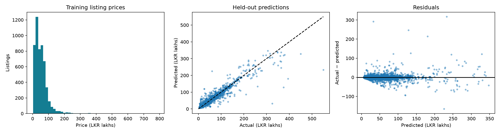
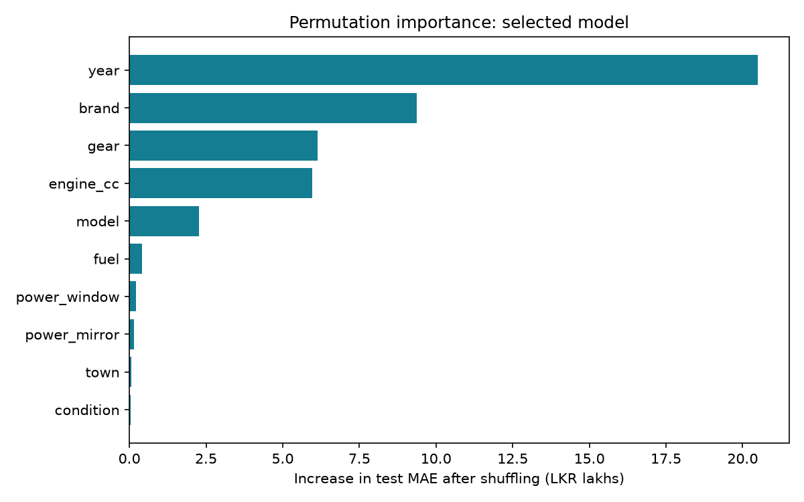
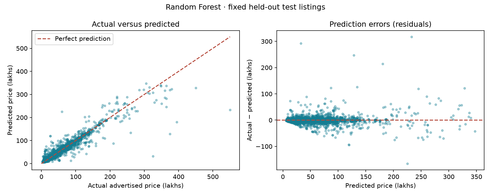
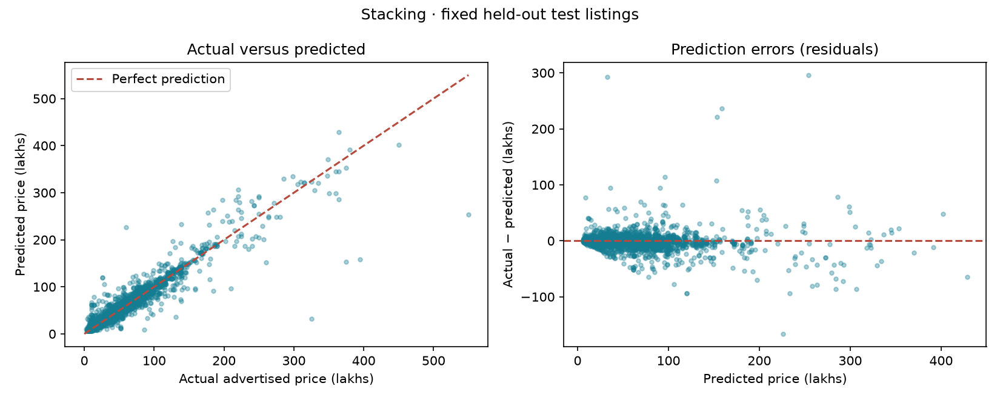
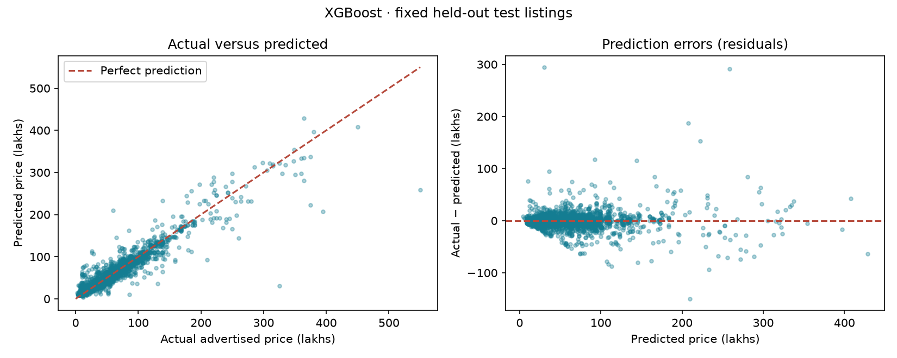

# Sri Lankan Vehicle Listing Price Prediction

## Objective
Estimate advertised vehicle prices from tabular listing characteristics and compare
Random Forest with XGBoost for the class activity. Intended users are students
and reviewers exploring historical asking-price relationships. This is a coursework
prototype, not a present-day vehicle valuation service.

## Source and provenance
Prasad Nirmal, *SriLankan Vehicle(Car) Price Dataset*, Kaggle version 3:
https://www.kaggle.com/datasets/prasadnirmal/srilankan-second-vehiclecar-price-dataset

Publisher metadata lists MIT licensing and describes listings scraped from Ikman.lk
and Riyasewana.com. The downloaded source has 9,788 rows and 17 columns,
including an exported index. Listings span 2024-12-03 to 2025-02-05.
Metadata and the original CSV are preserved. SHA-256: `4208d2673cf4d9c8d3d6042dc8a1b97004671812441975f5879550059fbce1ab`.

## Data analysis and limitations
- 18 exact duplicates were removed after trimming categories and ignoring the exported index.
- 0 records failed target/date/year validity checks.
- The downloaded table contains no literal nulls, but the publisher already preprocessed it.
- Every mileage value equals `(2025 - YOM) * 11000`. It is excluded as a deterministic proxy for year, not interpreted as measured mileage.
- The project owner confirmed that Price is in LKR lakhs. One lakh equals LKR 100,000. Training metrics remain in lakhs; the app converts monetary values to LKR.
- Model categories are numerous and often rare. Rare-category handling is learned separately within each fold.
- Listing prices are not verified transaction prices. The original listing IDs and full cleaning history are unavailable.

## Evaluation design
The latest record is reserved for a single-sample demonstration; all records with
its feature signature are excluded from development. The final test period starts
2025-01-24. Matching feature signatures are purged from earlier training data,
removing 411 potential overlaps. This conservative proxy can also
exclude distinct cars with identical features; it cannot establish actual identities.

There are 5,285 training records, 4,073 test records and one
demonstration record. Three expanding temporal folds are used inside training.
Validation groups are also excluded from each fold's training partition. The chosen
model minimizes mean validation MAE; test results are computed afterward and are
not used to select or retune it. Fold standard deviations describe variation over
three time windows, not confidence intervals.

## Preprocessing and parameter engineering
Numerical median imputation and categorical most-frequent imputation are fitted
within the pipeline. One-hot encoding pools categories with fewer than three
training observations and handles unknown categories. Both selected
tree models do not require normalization or scaling. Explicit model configurations
and every search result are saved in `experiments.csv` and `src/train.py`.

Random Forest varies tree depth and minimum leaf size while using 180 trees and
80% feature sampling. XGBoost varies depth and number of boosting rounds, with a
0.05 learning rate, 85% row/column sampling and explicit L1/L2 regularization.
A temporal stacking ensemble additionally combines fixed RF and XGBoost pipelines using scaled Ridge regression (alpha=10). Inner purged temporal folds generate meta-training predictions; outer purged temporal folds evaluate the complete stack. The existing test set had already been inspected before adding stacking, so this extension is exploratory.

## Results
All MAE/RMSE values below are in LKR lakhs (multiply by 100,000 for LKR).

| model | cv_mae | cv_std | test_mae | test_rmse | test_r2 |
|---|---|---|---|---|---|
| Random Forest | 7.148 | 0.146 | 5.830 | 14.440 | 0.893 |
| Stacking | 7.299 | 0.249 | 6.475 | 14.411 | 0.894 |
| XGBoost | 7.562 | 0.312 | 6.821 | 14.241 | 0.896 |

The validation-selected model is **Random Forest**. Its held-out MAE is
**5.830**, RMSE **14.440**, and
R² **0.893**. R² is not percentage accuracy. A difference in model scores
is descriptive; this experiment does not prove statistical superiority.

XGBoost has a lower test RMSE but a higher test MAE than
Random Forest: it performs better under the metric that penalizes large errors more
strongly, while Random Forest has smaller average absolute errors. The chosen metric
was MAE before evaluation.

## Model strengths and limitations
- **Random Forest:** models nonlinear interactions and offers flexible regularization; can struggle with rare vehicles and cannot reliably extrapolate beyond training prices.
- **XGBoost:** sequentially corrects errors and supports explicit regularization; sensitive to tuning, outliers and distribution changes.

Consult `errors_by_brand.csv` for subgroup counts and MAE. Do not draw strong
conclusions from brands with only a few test observations. `test_predictions.csv`
records individual errors. The residual plot helps identify whether expensive cars
or other regions of the target range have systematically larger errors.

## Interpretation
Manufacture year has the largest permutation importance, followed by brand,
transmission and engine capacity. This suggests that vehicle age and basic market
segment characteristics drive much of the fitted model’s discrimination. It does
not show that changing a feature would cause a corresponding price change.

Permutation importance measures the test MAE increase when a feature is shuffled.
It is descriptive analysis after evaluation; it was not used for further tuning.
Correlated features may share importance, and shuffling can create implausible
combinations. These are global associations, not causal effects or explanations
of a particular car's price.

## Comparison with an existing approach
Basnayaka (2023), *Prediction of Market Price for Used Cars in Sri Lanka Based on
Machine Learning Approaches*, IIT repository:
https://dlib.iit.ac.lk/xmlui/handle/123456789/1634

The abstract describes comparing linear regression, Random Forest, Extra Trees,
gradient boosting, LightGBM and XGBoost, plus averaging predictions. This project
compares a related subset and adds an explicit documented audit of deterministic
mileage and lakh-based price scaling, temporal evaluation, and feature-signature
purging. The repository abstract's reported “accuracy” is not a directly comparable
MAE/R² benchmark, and an identical dataset/split has not been verified. This is a
methodological comparison, not a claim to outperform that study. A broader literature
review is still appropriate before the final assignment submission.

## Single-sample inference
Reserved source row: 9763. Actual price (LKR lakhs): 30.950; prediction:
29.963; absolute error: 0.987.
The exported pipeline was reloaded and its prediction matched the in-memory model.
Run `python -m src.predict` to repeat this independently.

## Front end and reproducibility
The Streamlit interface accepts the actual model fields, validates inputs, displays
historical estimates in LKR, supports the held-out example and shows model
comparisons. Interface requirements are documented in `docs/interface.md`.
The fitted preprocessing and estimator are exported together in `models/model.pkl`.
Exact installed versions are saved in `requirements-lock.txt`.

## Remaining submission work
The lakh scale is based on the project owner’s confirmation.
Review the analysis and write the student's own interpretation; extend the literature
review if required. Confirm Moodle deadlines. Publish the repository and submit its
link or notebook individually. This project has not been published or submitted.

## Interactive model selection
The app saves and loads all three trained estimators separately. Select a model in
the Prediction model dropdown, then submit the same vehicle details to compare
estimates. The recommended default is selected by validation MAE.
Switching clears the previous result and displays the selected model's test MAE.
Downloaded predictions include the model name. The importance chart switches to the selected model's global permutation importance.

## Interpreting the model comparison

Random Forest is recommended by validation MAE. All three models use the same 4,073 held-out listings. MAE measures average error; RMSE emphasizes large errors; R² is unitless. See the comparison table for measured results, not claims of statistical superiority.

Stacking uses fixed base configurations and a Ridge meta-model trained on inner temporal out-of-fold predictions. Outer temporal folds evaluate the full stacking procedure. The test set is unchanged and was already examined before stacking was added; results are exploratory. All models describe historical asking prices, not completed sales or current valuations.

### Random Forest: strengths and limitations

**Strengths.** Combines many trees to capture nonlinear relationships between vehicle details. Averaging reduces dependence on one tree. Its recommendation status is determined by the comparison table.

**Limitations.** The training MAE is substantially smaller than the test MAE, suggesting some overfitting or a difference between the training and later test listings. Averaging tree outputs also limits extrapolation to prices outside the training range. Sparse examples of rare or expensive cars may be unreliable.

**Measured results.** Validation MAE: **7.15 lakhs**; test MAE: **5.83 lakhs**; test RMSE: **14.44 lakhs**; test R²: **0.893**. Training MAE was **2.68 lakhs**. Lower MAE/RMSE is better; higher R² is better. R² is unitless, not percentage accuracy.

**Feature-importance chart.** The strongest fields are **year, brand, gear, engine cc**, in that order. Longer bars mean shuffling that feature increased test error more. This is overall model reliance, not proof of causation, the direction of an effect, or an explanation for a single car. Correlated fields can share importance, and shuffling can produce unrealistic combinations.

**Actual-versus-predicted graph.** Points on the dashed diagonal are correct predictions. Points below it are underestimates; points above it are overestimates. Each point represents one unseen test listing.

**Residual graph.** Residual = actual price − predicted price. Positive values mean underestimation; negative values mean overestimation. A tight cloud around zero is desirable. The mean signed residual is **0.08 lakhs**; the largest absolute test error is **317.34 lakhs**. These describe the whole test set, not a guaranteed range for the current vehicle.

**What the graphs show here.** Most listings form a dense cluster at the lower end of the price range, broadly following the diagonal. Several high-priced listings fall well below the diagonal, indicating substantial underestimation. The residual plot has isolated large positive and negative errors, so neither model is uniformly reliable across all vehicles. The plots alone do not establish why those listings were difficult.

**Large-error interpretation.** RMSE (14.44) is much larger than MAE (5.83), consistent with some large errors having a strong effect on the squared-error metric. Inspect isolated points far from the diagonal/zero line; an average score can hide these failures.

### Stacking: strengths and limitations

**Strengths.** Combines fixed Random Forest and XGBoost pipelines with a scaled Ridge meta-model. Meta-training predictions come from purged, expanding temporal folds; base pipelines are then refitted on all training rows.

**Limitations.** Correlated base errors can limit gains. Training and inference cost more; early rows without out-of-fold predictions are excluded from meta-training. Stacking is not guaranteed to improve on either model. It was added after earlier test results were inspected, so this is an exploratory comparison on an existing holdout.

**Measured results.** Validation MAE: **7.30 lakhs**; test MAE: **6.47 lakhs**; test RMSE: **14.41 lakhs**; test R²: **0.894**. Training MAE was **4.78 lakhs**. Lower MAE/RMSE is better; higher R² is better. R² is unitless, not percentage accuracy.

**Feature-importance chart.** The strongest fields are **year, brand, engine cc, gear**, in that order. Longer bars mean shuffling that feature increased test error more. This is overall model reliance, not proof of causation, the direction of an effect, or an explanation for a single car. Correlated fields can share importance, and shuffling can produce unrealistic combinations.

**Actual-versus-predicted graph.** Points on the dashed diagonal are correct predictions. Points below it are underestimates; points above it are overestimates. Each point represents one unseen test listing.

**Residual graph.** Residual = actual price − predicted price. Positive values mean underestimation; negative values mean overestimation. A tight cloud around zero is desirable. The mean signed residual is **-0.90 lakhs**; the largest absolute test error is **296.06 lakhs**. These describe the whole test set, not a guaranteed range for the current vehicle.

**What the graphs show here.** Most listings form a dense cluster at the lower end of the price range, broadly following the diagonal. Several high-priced listings fall well below the diagonal, indicating substantial underestimation. The residual plot has isolated large positive and negative errors, so neither model is uniformly reliable across all vehicles. The plots alone do not establish why those listings were difficult.

**Large-error interpretation.** RMSE (14.41) is much larger than MAE (6.47), consistent with some large errors having a strong effect on the squared-error metric. Inspect isolated points far from the diagonal/zero line; an average score can hide these failures.

### XGBoost: strengths and limitations

**Strengths.** Builds trees sequentially to correct earlier errors and provides explicit regularization. In this experiment it achieved slightly lower test RMSE and slightly higher R², so it performed better under squared-error measures.

**Limitations.** It needs careful choices of depth, learning rate, number of trees and regularization. Its validation and test MAE were higher than Random Forest’s here, despite its better RMSE. Neither its smaller training–test gap nor its slightly higher R² proves it will generalize better to new markets.

**Measured results.** Validation MAE: **7.56 lakhs**; test MAE: **6.82 lakhs**; test RMSE: **14.24 lakhs**; test R²: **0.896**. Training MAE was **5.57 lakhs**. Lower MAE/RMSE is better; higher R² is better. R² is unitless, not percentage accuracy.

**Feature-importance chart.** The strongest fields are **year, brand, engine cc, gear**, in that order. Longer bars mean shuffling that feature increased test error more. This is overall model reliance, not proof of causation, the direction of an effect, or an explanation for a single car. Correlated fields can share importance, and shuffling can produce unrealistic combinations.

**Actual-versus-predicted graph.** Points on the dashed diagonal are correct predictions. Points below it are underestimates; points above it are overestimates. Each point represents one unseen test listing.

**Residual graph.** Residual = actual price − predicted price. Positive values mean underestimation; negative values mean overestimation. A tight cloud around zero is desirable. The mean signed residual is **-0.24 lakhs**; the largest absolute test error is **294.56 lakhs**. These describe the whole test set, not a guaranteed range for the current vehicle.

**What the graphs show here.** Most listings form a dense cluster at the lower end of the price range, broadly following the diagonal. Several high-priced listings fall well below the diagonal, indicating substantial underestimation. The residual plot has isolated large positive and negative errors, so neither model is uniformly reliable across all vehicles. The plots alone do not establish why those listings were difficult.

**Large-error interpretation.** RMSE (14.24) is much larger than MAE (6.82), consistent with some large errors having a strong effect on the squared-error metric. Inspect isolated points far from the diagonal/zero line; an average score can hide these failures.

