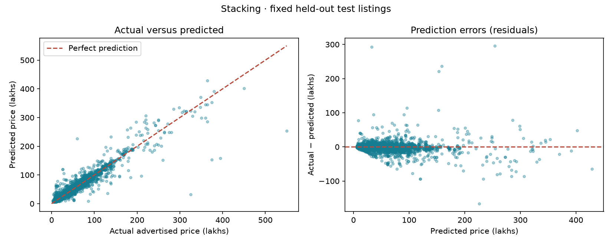
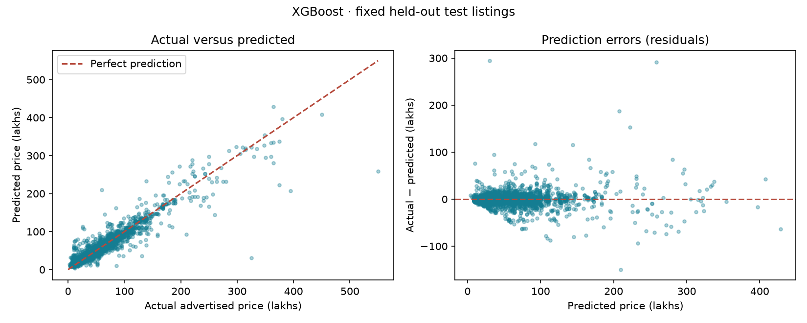
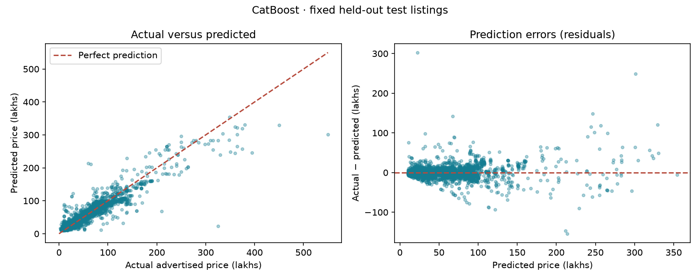
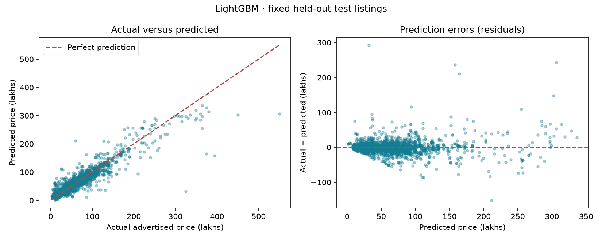
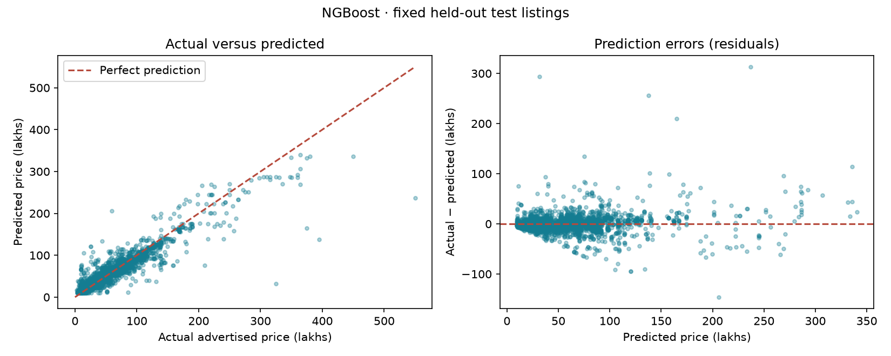
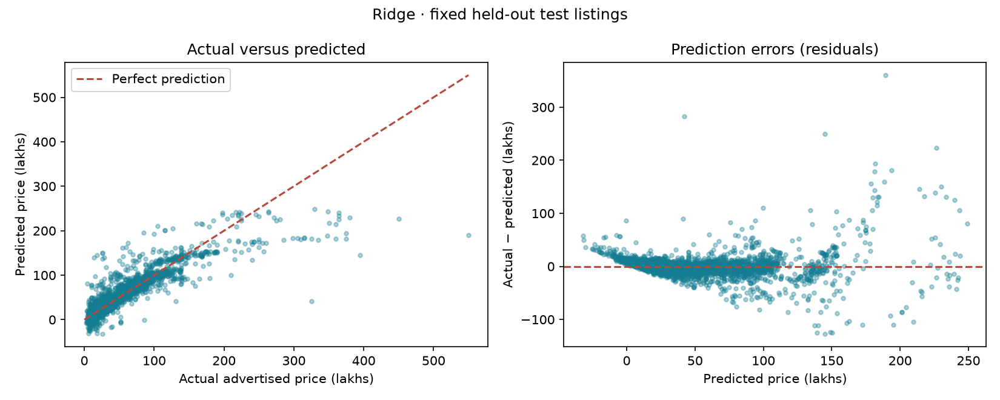

## Interpreting the model comparison

Random Forest is recommended by validation MAE. All models use the same 4,073 held-out listings. MAE measures average error; RMSE emphasizes large errors; R² is unitless. See the comparison table for measured results, not claims of statistical superiority.

Additional model candidates and stacking are exploratory additions after the test set was examined. Stacking uses fixed base configurations and a Ridge meta-model trained on inner temporal out-of-fold predictions. Outer temporal folds evaluate the full stacking procedure. The test set is unchanged and was already examined before stacking was added; results are exploratory. All models describe historical asking prices, not completed sales or current valuations.

### Random Forest: strengths and limitations

**Strengths.** Averages many trees to reduce prediction variance. Captures nonlinear relationships and interactions.

**Limitations.** Rare vehicles can have large errors. Cannot reliably extrapolate beyond training prices.

**Measured results.** Validation MAE: **7.15 lakhs**; test MAE: **5.83 lakhs**; test RMSE: **14.44 lakhs**; test R²: **0.893**. Training MAE was **2.68 lakhs**. Lower MAE/RMSE is better; higher R² is better. R² is unitless, not percentage accuracy.

**Feature-importance chart.** The strongest fields are **year, brand, gear, engine cc**, in that order. Longer bars mean shuffling that feature increased test error more. This is overall model reliance, not proof of causation, the direction of an effect, or an explanation for a single car. Correlated fields can share importance, and shuffling can produce unrealistic combinations.

**Actual-versus-predicted graph.** Points on the dashed diagonal are correct predictions. Points below it are underestimates; points above it are overestimates. Each point represents one unseen test listing.

**Residual graph.** Residual = actual price − predicted price. Positive values mean underestimation; negative values mean overestimation. A tight cloud around zero is desirable. The mean signed residual is **0.08 lakhs**; the largest absolute test error is **317.34 lakhs**. These describe the whole test set, not a guaranteed range for the current vehicle.

**What the graphs show here.** Most listings form a dense cluster at the lower end of the price range, broadly following the diagonal. The diagnostics show the direction and size of errors for this model. Points far from the diagonal or zero line identify large errors; no model is guaranteed reliable across all vehicles. The plots alone do not establish why those listings were difficult.

**Large-error interpretation.** RMSE (14.44) is much larger than MAE (5.83), consistent with some large errors having a strong effect on the squared-error metric. Inspect isolated points far from the diagonal/zero line; an average score can hide these failures.

### Stacking: strengths and limitations

**Strengths.** Combines Random Forest and XGBoost predictions using Ridge. Meta-model learns from later out-of-fold predictions.

**Limitations.** Similar base-model errors can limit improvement. More training work; early rows are excluded from meta-training.

**Measured results.** Validation MAE: **7.30 lakhs**; test MAE: **6.47 lakhs**; test RMSE: **14.41 lakhs**; test R²: **0.894**. Training MAE was **4.78 lakhs**. Lower MAE/RMSE is better; higher R² is better. R² is unitless, not percentage accuracy.

**Feature-importance chart.** The strongest fields are **year, brand, engine cc, gear**, in that order. Longer bars mean shuffling that feature increased test error more. This is overall model reliance, not proof of causation, the direction of an effect, or an explanation for a single car. Correlated fields can share importance, and shuffling can produce unrealistic combinations.

**Actual-versus-predicted graph.** Points on the dashed diagonal are correct predictions. Points below it are underestimates; points above it are overestimates. Each point represents one unseen test listing.

**Residual graph.** Residual = actual price − predicted price. Positive values mean underestimation; negative values mean overestimation. A tight cloud around zero is desirable. The mean signed residual is **-0.90 lakhs**; the largest absolute test error is **296.06 lakhs**. These describe the whole test set, not a guaranteed range for the current vehicle.

**What the graphs show here.** Most listings form a dense cluster at the lower end of the price range, broadly following the diagonal. The diagnostics show the direction and size of errors for this model. Points far from the diagonal or zero line identify large errors; no model is guaranteed reliable across all vehicles. The plots alone do not establish why those listings were difficult.

**Large-error interpretation.** RMSE (14.41) is much larger than MAE (6.47), consistent with some large errors having a strong effect on the squared-error metric. Inspect isolated points far from the diagonal/zero line; an average score can hide these failures.

### XGBoost: strengths and limitations

**Strengths.** Successive trees correct earlier errors. Regularization controls complex nonlinear patterns.

**Limitations.** Sensitive to parameter choices. Rare categories and market changes can still cause large errors.

**Measured results.** Validation MAE: **7.56 lakhs**; test MAE: **6.82 lakhs**; test RMSE: **14.24 lakhs**; test R²: **0.896**. Training MAE was **5.57 lakhs**. Lower MAE/RMSE is better; higher R² is better. R² is unitless, not percentage accuracy.

**Feature-importance chart.** The strongest fields are **year, brand, engine cc, gear**, in that order. Longer bars mean shuffling that feature increased test error more. This is overall model reliance, not proof of causation, the direction of an effect, or an explanation for a single car. Correlated fields can share importance, and shuffling can produce unrealistic combinations.

**Actual-versus-predicted graph.** Points on the dashed diagonal are correct predictions. Points below it are underestimates; points above it are overestimates. Each point represents one unseen test listing.

**Residual graph.** Residual = actual price − predicted price. Positive values mean underestimation; negative values mean overestimation. A tight cloud around zero is desirable. The mean signed residual is **-0.24 lakhs**; the largest absolute test error is **294.56 lakhs**. These describe the whole test set, not a guaranteed range for the current vehicle.

**What the graphs show here.** Most listings form a dense cluster at the lower end of the price range, broadly following the diagonal. The diagnostics show the direction and size of errors for this model. Points far from the diagonal or zero line identify large errors; no model is guaranteed reliable across all vehicles. The plots alone do not establish why those listings were difficult.

**Large-error interpretation.** RMSE (14.24) is much larger than MAE (6.82), consistent with some large errors having a strong effect on the squared-error metric. Inspect isolated points far from the diagonal/zero line; an average score can hide these failures.

### CatBoost: strengths and limitations

**Strengths.** Uses categorical fields directly, without external one-hot encoding. Can capture patterns across many vehicle model categories.

**Limitations.** Rare categories still have limited supporting evidence. Categorical statistics must be learned inside training folds.

**Measured results.** Validation MAE: **8.74 lakhs**; test MAE: **8.41 lakhs**; test RMSE: **15.61 lakhs**; test R²: **0.875**. Training MAE was **7.76 lakhs**. Lower MAE/RMSE is better; higher R² is better. R² is unitless, not percentage accuracy.

**Feature-importance chart.** The strongest fields are **year, brand, engine cc, gear**, in that order. Longer bars mean shuffling that feature increased test error more. This is overall model reliance, not proof of causation, the direction of an effect, or an explanation for a single car. Correlated fields can share importance, and shuffling can produce unrealistic combinations.

**Actual-versus-predicted graph.** Points on the dashed diagonal are correct predictions. Points below it are underestimates; points above it are overestimates. Each point represents one unseen test listing.

**Residual graph.** Residual = actual price − predicted price. Positive values mean underestimation; negative values mean overestimation. A tight cloud around zero is desirable. The mean signed residual is **0.11 lakhs**; the largest absolute test error is **302.58 lakhs**. These describe the whole test set, not a guaranteed range for the current vehicle.

**What the graphs show here.** Most listings form a dense cluster at the lower end of the price range, broadly following the diagonal. The diagnostics show the direction and size of errors for this model. Points far from the diagonal or zero line identify large errors; no model is guaranteed reliable across all vehicles. The plots alone do not establish why those listings were difficult.

**Large-error interpretation.** RMSE (15.61) is much larger than MAE (8.41), consistent with some large errors having a strong effect on the squared-error metric. Inspect isolated points far from the diagonal/zero line; an average score can hide these failures.

### LightGBM: strengths and limitations

**Strengths.** Histogram-based boosting is an efficient tabular candidate. Leaf-wise trees capture nonlinear relationships.

**Limitations.** Leaf growth can overfit small groups without constraints. This implementation uses one-hot categories; unseen labels provide limited information.

**Measured results.** Validation MAE: **9.41 lakhs**; test MAE: **7.59 lakhs**; test RMSE: **15.28 lakhs**; test R²: **0.880**. Training MAE was **7.14 lakhs**. Lower MAE/RMSE is better; higher R² is better. R² is unitless, not percentage accuracy.

**Feature-importance chart.** The strongest fields are **year, brand, engine cc, gear**, in that order. Longer bars mean shuffling that feature increased test error more. This is overall model reliance, not proof of causation, the direction of an effect, or an explanation for a single car. Correlated fields can share importance, and shuffling can produce unrealistic combinations.

**Actual-versus-predicted graph.** Points on the dashed diagonal are correct predictions. Points below it are underestimates; points above it are overestimates. Each point represents one unseen test listing.

**Residual graph.** Residual = actual price − predicted price. Positive values mean underestimation; negative values mean overestimation. A tight cloud around zero is desirable. The mean signed residual is **0.02 lakhs**; the largest absolute test error is **293.00 lakhs**. These describe the whole test set, not a guaranteed range for the current vehicle.

**What the graphs show here.** Most listings form a dense cluster at the lower end of the price range, broadly following the diagonal. The diagnostics show the direction and size of errors for this model. Points far from the diagonal or zero line identify large errors; no model is guaranteed reliable across all vehicles. The plots alone do not establish why those listings were difficult.

**Large-error interpretation.** RMSE (15.28) is much larger than MAE (7.59), consistent with some large errors having a strong effect on the squared-error metric. Inspect isolated points far from the diagonal/zero line; an average score can hide these failures.

### NGBoost: strengths and limitations

**Strengths.** Learns both location and scale of a price distribution using natural gradients. Provides a nonlinear probabilistic comparison to point-prediction models.

**Limitations.** Normal-distribution assumptions may poorly describe skewed prices and outliers. Uncertainty can be miscalibrated; negative estimates and interval bounds are possible.

**Measured results.** Validation MAE: **9.43 lakhs**; test MAE: **8.58 lakhs**; test RMSE: **16.45 lakhs**; test R²: **0.861**. Training MAE was **8.20 lakhs**. Lower MAE/RMSE is better; higher R² is better. R² is unitless, not percentage accuracy.

**Feature-importance chart.** The strongest fields are **year, brand, engine cc, gear**, in that order. Longer bars mean shuffling that feature increased test error more. This is overall model reliance, not proof of causation, the direction of an effect, or an explanation for a single car. Correlated fields can share importance, and shuffling can produce unrealistic combinations.

**Actual-versus-predicted graph.** Points on the dashed diagonal are correct predictions. Points below it are underestimates; points above it are overestimates. Each point represents one unseen test listing.

**Residual graph.** Residual = actual price − predicted price. Positive values mean underestimation; negative values mean overestimation. A tight cloud around zero is desirable. The mean signed residual is **-0.19 lakhs**; the largest absolute test error is **313.17 lakhs**. These describe the whole test set, not a guaranteed range for the current vehicle.

**What the graphs show here.** Most listings form a dense cluster at the lower end of the price range, broadly following the diagonal. The diagnostics show the direction and size of errors for this model. Points far from the diagonal or zero line identify large errors; no model is guaranteed reliable across all vehicles. The plots alone do not establish why those listings were difficult.

**Large-error interpretation.** RMSE (16.45) is much larger than MAE (8.58), consistent with some large errors having a strong effect on the squared-error metric. Inspect isolated points far from the diagonal/zero line; an average score can hide these failures.

### Ridge: strengths and limitations

**Strengths.** Regularized linear reference for measuring the benefit of tree models. Simple additive structure and relatively inexpensive inference.

**Limitations.** Does not automatically learn nonlinear interactions. Extrapolation can produce unrealistic or negative prices.

**Measured results.** Validation MAE: **11.12 lakhs**; test MAE: **9.99 lakhs**; test RMSE: **20.69 lakhs**; test R²: **0.781**. Training MAE was **9.23 lakhs**. Lower MAE/RMSE is better; higher R² is better. R² is unitless, not percentage accuracy.

**Feature-importance chart.** The strongest fields are **year, brand, model, engine cc**, in that order. Longer bars mean shuffling that feature increased test error more. This is overall model reliance, not proof of causation, the direction of an effect, or an explanation for a single car. Correlated fields can share importance, and shuffling can produce unrealistic combinations.

**Actual-versus-predicted graph.** Points on the dashed diagonal are correct predictions. Points below it are underestimates; points above it are overestimates. Each point represents one unseen test listing.

**Residual graph.** Residual = actual price − predicted price. Positive values mean underestimation; negative values mean overestimation. A tight cloud around zero is desirable. The mean signed residual is **-0.39 lakhs**; the largest absolute test error is **360.61 lakhs**. These describe the whole test set, not a guaranteed range for the current vehicle.

**What the graphs show here.** Most listings form a dense cluster at the lower end of the price range, broadly following the diagonal. The diagnostics show the direction and size of errors for this model. Points far from the diagonal or zero line identify large errors; no model is guaranteed reliable across all vehicles. The plots alone do not establish why those listings were difficult.

**Large-error interpretation.** RMSE (20.69) is much larger than MAE (9.99), consistent with some large errors having a strong effect on the squared-error metric. Inspect isolated points far from the diagonal/zero line; an average score can hide these failures.

