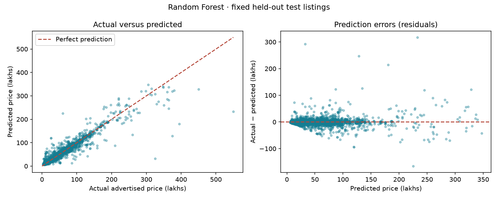
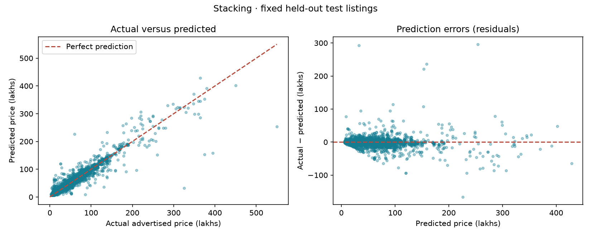
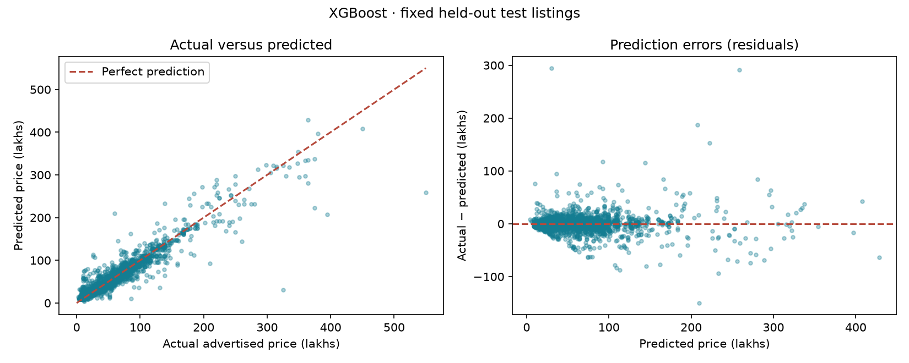

## Interpreting the model comparison

Random Forest is recommended by validation MAE. All three models use the same 4,073 held-out listings. MAE measures average error; RMSE emphasizes large errors; R² is unitless. See the comparison table for measured results, not claims of statistical superiority.

Stacking uses fixed base configurations and a Ridge meta-model trained on inner temporal out-of-fold predictions. Outer temporal folds evaluate the full stacking procedure. The test set is unchanged and was already examined before stacking was added; results are exploratory. All models describe historical asking prices, not completed sales or current valuations.

### Random Forest: strengths and limitations

**Strengths.** Combines many trees to capture nonlinear relationships between vehicle details. Averaging reduces dependence on one tree. Its recommendation status is determined by the comparison table.

**Limitations.** The training MAE is substantially smaller than the test MAE, suggesting some overfitting or a difference between the training and later test listings. Averaging tree outputs also limits extrapolation to prices outside the training range. Sparse examples of rare or expensive cars may be unreliable.

**Measured results.** Validation MAE: **7.15 lakhs**; test MAE: **5.83 lakhs**; test RMSE: **14.44 lakhs**; test R²: **0.893**. Training MAE was **2.68 lakhs**. Lower MAE/RMSE is better; higher R² is better. R² is unitless, not percentage accuracy.

**Feature-importance chart.** The strongest fields are **year, brand, gear, engine cc**, in that order. Longer bars mean shuffling that feature increased test error more. This is overall model reliance, not proof of causation, the direction of an effect, or an explanation for a single car. Correlated fields can share importance, and shuffling can produce unrealistic combinations.

**Actual-versus-predicted graph.** Points on the dashed diagonal are correct predictions. Points below it are underestimates; points above it are overestimates. Each point represents one unseen test listing.

**Residual graph.** Residual = actual price − predicted price. Positive values mean underestimation; negative values mean overestimation. A tight cloud around zero is desirable. The mean signed residual is **0.08 lakhs**; the largest absolute test error is **317.34 lakhs**. These describe the whole test set, not a guaranteed range for the current vehicle.

**What the graphs show here.** Most listings form a dense cluster at the lower end of the price range, broadly following the diagonal. Several high-priced listings fall well below the diagonal, indicating substantial underestimation. The residual plot has isolated large positive and negative errors, so neither model is uniformly reliable across all vehicles. The plots alone do not establish why those listings were difficult.

**Large-error interpretation.** RMSE (14.44) is much larger than MAE (5.83), consistent with some large errors having a strong effect on the squared-error metric. Inspect isolated points far from the diagonal/zero line; an average score can hide these failures.

### Stacking: strengths and limitations

**Strengths.** Combines fixed Random Forest and XGBoost pipelines with a scaled Ridge meta-model. Meta-training predictions come from purged, expanding temporal folds; base pipelines are then refitted on all training rows.

**Limitations.** Correlated base errors can limit gains. Training and inference cost more; early rows without out-of-fold predictions are excluded from meta-training. Stacking is not guaranteed to improve on either model. It was added after earlier test results were inspected, so this is an exploratory comparison on an existing holdout.

**Measured results.** Validation MAE: **7.30 lakhs**; test MAE: **6.47 lakhs**; test RMSE: **14.41 lakhs**; test R²: **0.894**. Training MAE was **4.78 lakhs**. Lower MAE/RMSE is better; higher R² is better. R² is unitless, not percentage accuracy.

**Feature-importance chart.** The strongest fields are **year, brand, engine cc, gear**, in that order. Longer bars mean shuffling that feature increased test error more. This is overall model reliance, not proof of causation, the direction of an effect, or an explanation for a single car. Correlated fields can share importance, and shuffling can produce unrealistic combinations.

**Actual-versus-predicted graph.** Points on the dashed diagonal are correct predictions. Points below it are underestimates; points above it are overestimates. Each point represents one unseen test listing.

**Residual graph.** Residual = actual price − predicted price. Positive values mean underestimation; negative values mean overestimation. A tight cloud around zero is desirable. The mean signed residual is **-0.90 lakhs**; the largest absolute test error is **296.06 lakhs**. These describe the whole test set, not a guaranteed range for the current vehicle.

**What the graphs show here.** Most listings form a dense cluster at the lower end of the price range, broadly following the diagonal. Several high-priced listings fall well below the diagonal, indicating substantial underestimation. The residual plot has isolated large positive and negative errors, so neither model is uniformly reliable across all vehicles. The plots alone do not establish why those listings were difficult.

**Large-error interpretation.** RMSE (14.41) is much larger than MAE (6.47), consistent with some large errors having a strong effect on the squared-error metric. Inspect isolated points far from the diagonal/zero line; an average score can hide these failures.

### XGBoost: strengths and limitations

**Strengths.** Builds trees sequentially to correct earlier errors and provides explicit regularization. In this experiment it achieved slightly lower test RMSE and slightly higher R², so it performed better under squared-error measures.

**Limitations.** It needs careful choices of depth, learning rate, number of trees and regularization. Its validation and test MAE were higher than Random Forest’s here, despite its better RMSE. Neither its smaller training–test gap nor its slightly higher R² proves it will generalize better to new markets.

**Measured results.** Validation MAE: **7.56 lakhs**; test MAE: **6.82 lakhs**; test RMSE: **14.24 lakhs**; test R²: **0.896**. Training MAE was **5.57 lakhs**. Lower MAE/RMSE is better; higher R² is better. R² is unitless, not percentage accuracy.

**Feature-importance chart.** The strongest fields are **year, brand, engine cc, gear**, in that order. Longer bars mean shuffling that feature increased test error more. This is overall model reliance, not proof of causation, the direction of an effect, or an explanation for a single car. Correlated fields can share importance, and shuffling can produce unrealistic combinations.

**Actual-versus-predicted graph.** Points on the dashed diagonal are correct predictions. Points below it are underestimates; points above it are overestimates. Each point represents one unseen test listing.

**Residual graph.** Residual = actual price − predicted price. Positive values mean underestimation; negative values mean overestimation. A tight cloud around zero is desirable. The mean signed residual is **-0.24 lakhs**; the largest absolute test error is **294.56 lakhs**. These describe the whole test set, not a guaranteed range for the current vehicle.

**What the graphs show here.** Most listings form a dense cluster at the lower end of the price range, broadly following the diagonal. Several high-priced listings fall well below the diagonal, indicating substantial underestimation. The residual plot has isolated large positive and negative errors, so neither model is uniformly reliable across all vehicles. The plots alone do not establish why those listings were difficult.

**Large-error interpretation.** RMSE (14.24) is much larger than MAE (6.82), consistent with some large errors having a strong effect on the squared-error metric. Inspect isolated points far from the diagonal/zero line; an average score can hide these failures.

